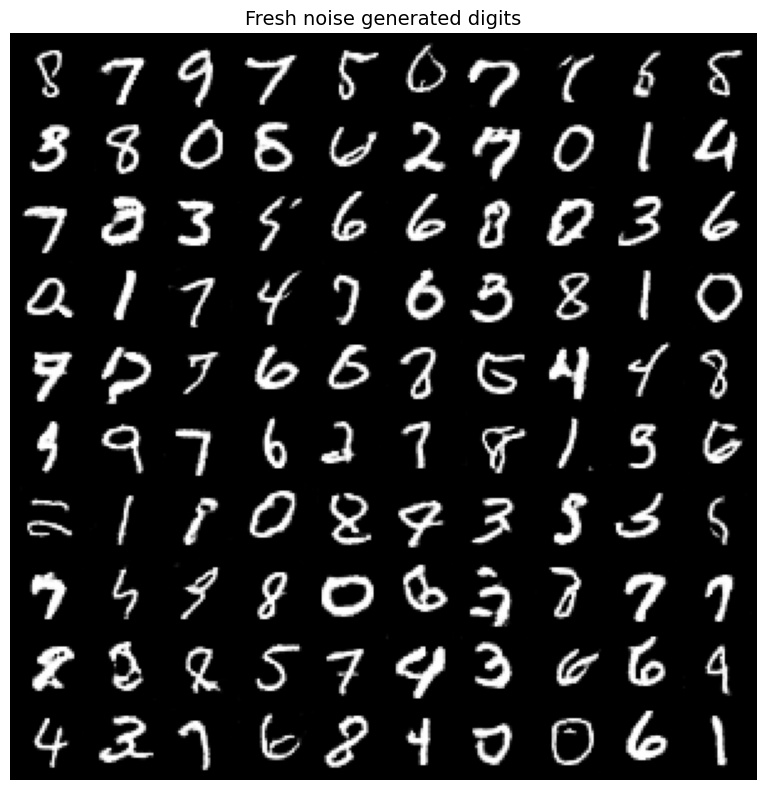
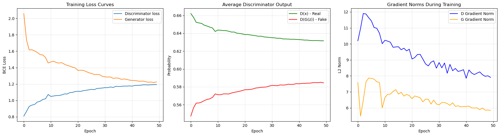
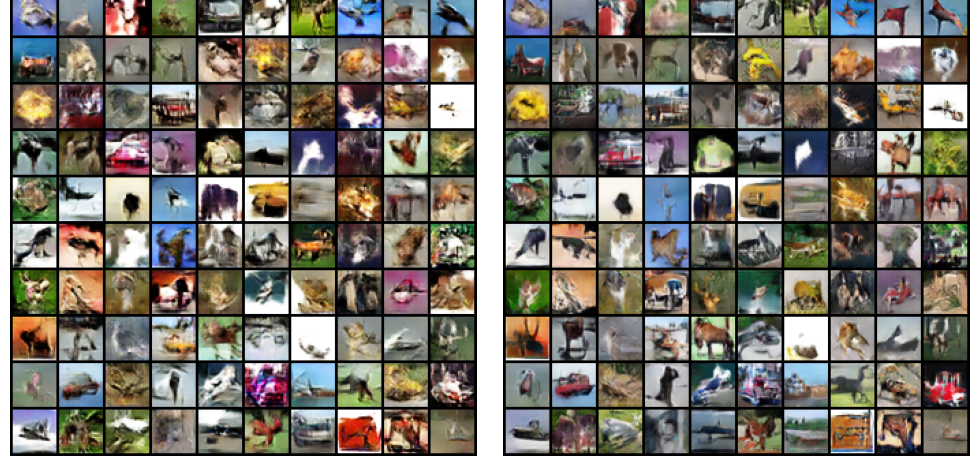
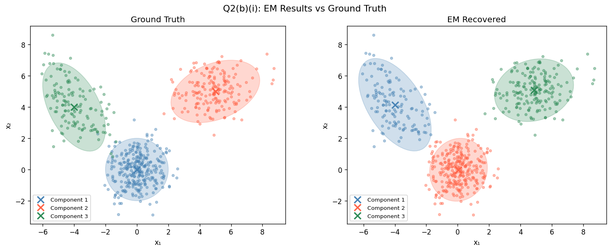
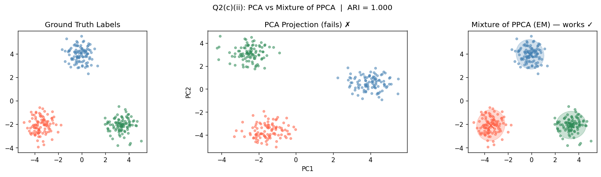

# Generative models: GANs and EM for Gaussian mixtures

Two approaches to learning a data distribution, implemented and analysed in Python:

1. **Generative adversarial networks (GANs)**: DCGANs in PyTorch that learn to generate handwritten digits (MNIST) and natural images (CIFAR-10).
2. **Expectation–Maximisation (EM)**: a Gaussian mixture model fitted with EM written from scratch in NumPy, with model selection (BIC/AIC) and an analysis of when PCA does and does not preserve cluster structure.

This was group coursework for ST349 at the University of Warwick (March 2026), done in a team of three. It received a mark of **88%**.

**My role:** I implemented the DCGAN on CIFAR-10 ([`02_dcgan_cifar10.ipynb`](notebooks/02_dcgan_cifar10.ipynb)) and assisted with the MNIST GAN and the EM and PCA analysis.

## Results

### DCGAN on MNIST

The generator turns random noise into digits after 50 epochs of training:

<p align="center"></p>

Moving smoothly through the latent space between two random points shows that the model learned a continuous representation instead of memorising examples:

<p align="center"></p>

Training diagnostics: losses, discriminator outputs on real and fake images, and gradient norms. Training stays stable, with no collapse or divergence:



### DCGAN on CIFAR-10

A wider DCGAN, trained for 30 epochs on a Tesla T4 GPU, with label smoothing, horizontal-flip augmentation and separate learning rates for the generator and discriminator (TTUR). Generated samples at epoch 12 (left) and epoch 30 (right):



The notebook analyses the two training phases. The generator improves quickly up to about epoch 12, then the discriminator recovers. It also tests changes to the model (a wider generator), the data (augmentation, a reduced dataset) and the loss (a least-squares GAN objective).

### EM for a mixture of Gaussians

EM implemented from scratch: E-step responsibilities, M-step updates, log-likelihood convergence, k-means initialisation and covariance regularisation. It recovers the three true components from 600 unlabelled points. The colours differ from the ground truth only because EM numbers its components arbitrarily (label switching).



- **Multiple restarts:** 10 restarts with k-means and random initialisation all converge to the same log-likelihood (−2386.5), which shows the solution is stable.
- **Choosing K:** BIC reaches its minimum at K = 3, the true number of components. AIC stays almost flat for K ≥ 3.

### PCA vs mixture of PPCA

When clusters lie along one direction, the first principal component explains 95.7% of the variance and separates them. When the clusters sit at the corners of a triangle, no single direction separates all three, so projecting onto the first component mixes two of them. A mixture model with a separate covariance for each cluster (fitted by EM) recovers all three exactly (adjusted Rand index = 1.0):



## Repository structure

```
notebooks/
  01_dcgan_mnist.ipynb               DCGAN on MNIST: design, training, diagnostics, samples
  02_dcgan_cifar10.ipynb             Wider DCGAN on CIFAR-10: results, analysis, improvements
  03_em_mixture_of_gaussians.ipynb   EM from scratch, restarts, BIC/AIC, PCA vs mixture of PPCA
assets/                              Figures used in this README
```

The notebooks are stored with their outputs, so they can be read on GitHub without running anything.

## Running the notebooks

```bash
git clone https://github.com/nicolaspm-io/generative-models-gan-em.git
cd generative-models-gan-em
python -m venv .venv && source .venv/bin/activate
pip install -r requirements.txt
jupyter lab
```

- MNIST and CIFAR-10 download automatically into `./data/` the first time a notebook runs.
- The GAN notebooks use a GPU when one is available (CUDA, or Apple Silicon for the MNIST notebook). On a CPU they work but are slow. The CIFAR-10 model was trained on a Tesla T4 in Google Colab.
- In `02_dcgan_cifar10.ipynb`, the results cells read the image grids and metrics that the training code in the appendix writes to `experimentations/`. Run the appendix first if you want to regenerate them.
- `03_em_mixture_of_gaussians.ipynb` needs no GPU and runs in seconds.

## Tech stack

Python · PyTorch · torchvision · NumPy · SciPy · scikit-learn · pandas · Matplotlib · Jupyter
